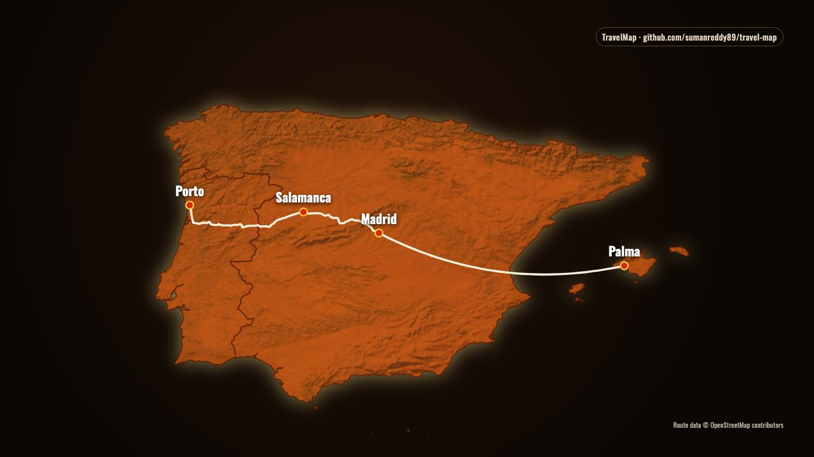
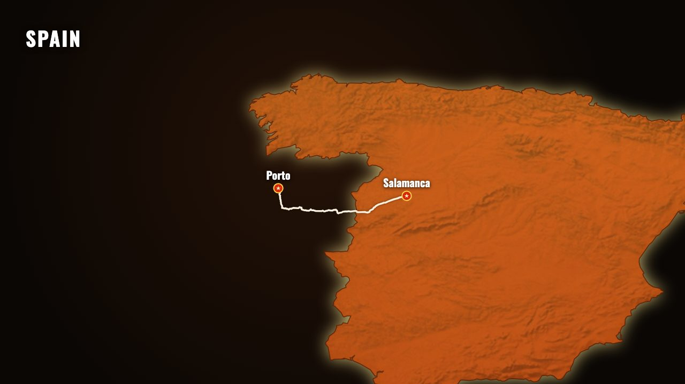
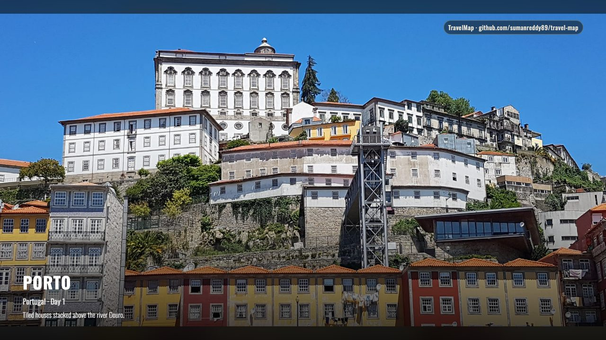
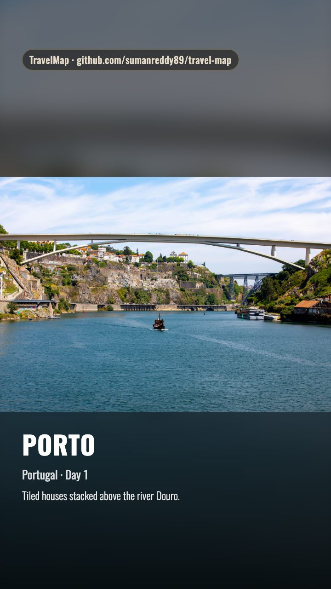

# TravelMap

Turn a route of places (with your own photos/videos) into a Globe Trekker-style
travel video: an animated, glowing map traces the route between stops, cutting
to your media at each destination with AI-written narration.

[](https://github.com/sumanreddy89/travel-map/releases/download/demo-film-v5/demo-landscape.mp4)

*The demo film, "Porto to Palma" (50s, 1920×1080, silent): by car, train and plane. Click the poster or [download the MP4](https://github.com/sumanreddy89/travel-map/releases/download/demo-film-v5/demo-landscape.mp4) (48MB; [portrait version](https://github.com/sumanreddy89/travel-map/releases/download/demo-film-v5/demo-portrait.mp4), 39MB). Or render it yourself in a few minutes with the commands below.*

**Don't want to set anything up?** A hosted version (paste a trip, get the MP4) is being considered. [Join the waitlist](https://sumanreddy89.github.io/travel-map/hosted/) if you'd use it.

| The route draws itself | Then your photos at each stop | Portrait, for phones |
|---|---|---|
|  |  |  |

### Try it: no API keys, no map download

```bash
npm ci
npm run demo:prepare   # one-time headless browser download
npm run demo:render    # out/demo-landscape.mp4
```

Add `-- --orientation portrait` to either command for the 1080×1920 phone version. The demo renders a checked-in, illustrative trip with the network blocked. Photo and map sources: [docs/demo/ASSETS.md](docs/demo/ASSETS.md). More: [docs/demo/README.md](docs/demo/README.md).

### Year in travel

A recap film of your year: it opens by counting up your countries, cities, kilometres and flights, flies the whole route, and ends on a share card with the same numbers. Try the sample year, also keyless and offline:

```bash
node remotion/scripts/demo.mjs render --trip year                         # out/demo-year-landscape.mp4
node remotion/scripts/demo.mjs render --trip year --orientation portrait  # out/demo-year-portrait.mp4
```

For your own year, with the server running (see below), paste one city per line, in order: `city | date | how you got there` (plane, train or car; plane if left out). Add a country when a name is ambiguous (`Valencia, ES`). The year comes from your dates, or a first line like `year: 2026`.

```bash
curl -s localhost:4000/api/trips/year -H 'content-type: application/json' \
  -d '{"text": "Lisbon | 2026-02-14\nMadrid | 2026-03-20 | plane\nBarcelona | 2026-04-02 | train"}'
```

Cities are matched against a bundled list of about 1,250 major cities ([Natural Earth](https://www.naturalearthdata.com/), public domain; `server/places/cities.json`), so nothing is looked up online. A line it can't read comes back as an error naming the line. Year films have no narration or voiceover, so they need no API keys beyond the map data.

## Full workflow: your own trips

Making films of your own trips needs API keys (narration and voiceover use paid services) and a one-time ~600MB map-data download, as below. What leaves your machine is listed under [What stays on your machine](#what-stays-on-your-machine).

### Setup

You need Node.js 20 or newer and ffmpeg (which includes `ffprobe`; macOS: `brew install ffmpeg`, Ubuntu: `sudo apt install ffmpeg`).

```bash
npm install
```

Copy `server/.env.example` to `server/.env` and fill in your own keys:

```bash
cp server/.env.example server/.env
```

```
ANTHROPIC_API_KEY=...     # console.anthropic.com - narration + closing lines
ELEVENLABS_API_KEY=...    # elevenlabs.io - voiceover TTS
ELEVENLABS_VOICE_ID=...   # must be a voice available to your ElevenLabs plan/account
PORT=4000
```

### Cartography data (one-time, not in the repo - ~600MB raw)

Map scenes need Natural Earth boundary + shaded-relief data. It's gitignored
rather than committed, so fetch and convert it once:

```bash
mkdir -p data/geo-raw && cd data/geo-raw
curl -sS -o countries.zip https://naciscdn.org/naturalearth/10m/cultural/ne_10m_admin_0_countries.zip
unzip -q countries.zip -d countries
curl -sS -o admin1.zip https://naciscdn.org/naturalearth/10m/cultural/ne_10m_admin_1_states_provinces.zip
unzip -q admin1.zip -d admin1
curl -sS -o relief.zip https://naciscdn.org/naturalearth/10m/raster/NE1_LR_LC_SR_W.zip
unzip -q relief.zip -d relief_hr
cd ../../server && npx tsx src/scripts/convertGeo.ts
```

That last command writes `remotion/public/geo/countries.json` and `admin1.json`.

### Check your setup

```bash
npm run doctor
```

It checks Node, ffmpeg and ffprobe, your keys in `server/.env` (without printing them) and the converted map data, and says how to fix anything missing. It doesn't call any paid service.
Per-country terrain textures (`remotion/public/terrain/*.png`) generate and
cache automatically the first time a trip visits that country.

## Run

```bash
npm run dev:server   # API on http://localhost:4000
npm run dev:web      # UI on http://localhost:5173
```

Open http://localhost:5173, create a trip, add stops (search or click the
map), upload photos/videos per stop, then click "Generate video".

## Preview map/scene work in isolation

```bash
npm run studio   # opens Remotion Studio with the demo trip (remotion/src/demo/demoProps.json)
```

## Notes

- Videos carry a small "TravelMap · github.com/sumanreddy89/travel-map" credit
  by default; untick "Show TravelMap credit" next to the format choice to drop
  it. Map scenes with a road route also show "Route data © OpenStreetMap
  contributors", which the routing data's licence requires.
- Background music is not auto-downloaded (copyright); drop an mp3/wav/m4a
  into `remotion/public/music/` and it's picked up automatically by every
  render at low volume - no per-trip wiring needed.
- The photo/video panel shown beside the map during transitions can be
  toggled off via `SHOW_MEDIA_PANEL_IN_MAP_SCENES` in `remotion/src/config.ts`.
- `data/` holds all trip content (uploads, generated audio, output videos),
  `data/geo-raw/` the raw Natural Earth source files, and `server/.env` your
  API keys - all gitignored.

## What stays on your machine

Your photos, videos, generated audio and finished videos stay local; the
server only listens on 127.0.0.1. Some trip details do go to outside services
to build the video:

| Service | What it receives |
|---|---|
| Anthropic | Trip title, stop names and your notes, to write the narration |
| ElevenLabs | The narration text, to read it aloud |
| OpenStreetMap Nominatim | Place names you search for |
| OSRM (project-osrm.org) | Stop coordinates, to draw the route |
| OpenFreeMap | Map tile requests for the area you're viewing |

## Tests

```bash
npm test
```

## Licence

Code: [MIT](LICENSE). The music once tracked in this repo is not covered and
stays all rights reserved; demo assets keep their own licences. See
[NOTICE.md](NOTICE.md) and [docs/demo/ASSETS.md](docs/demo/ASSETS.md).
