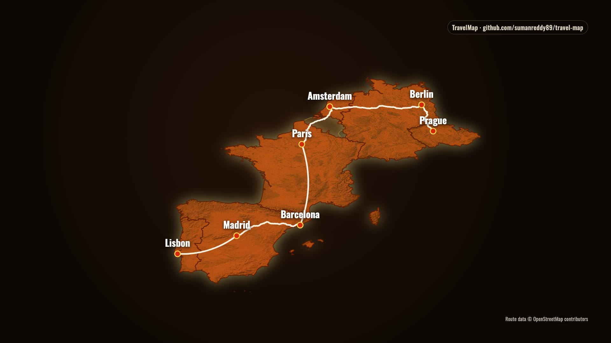
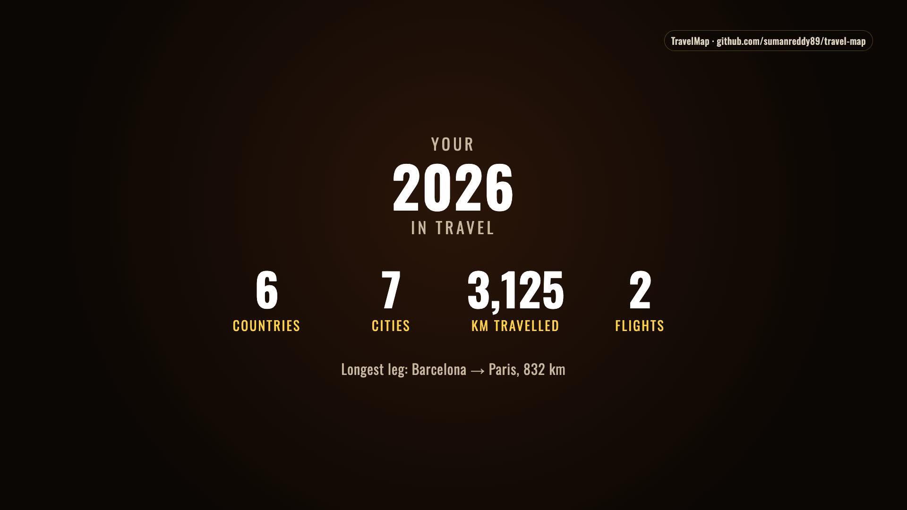
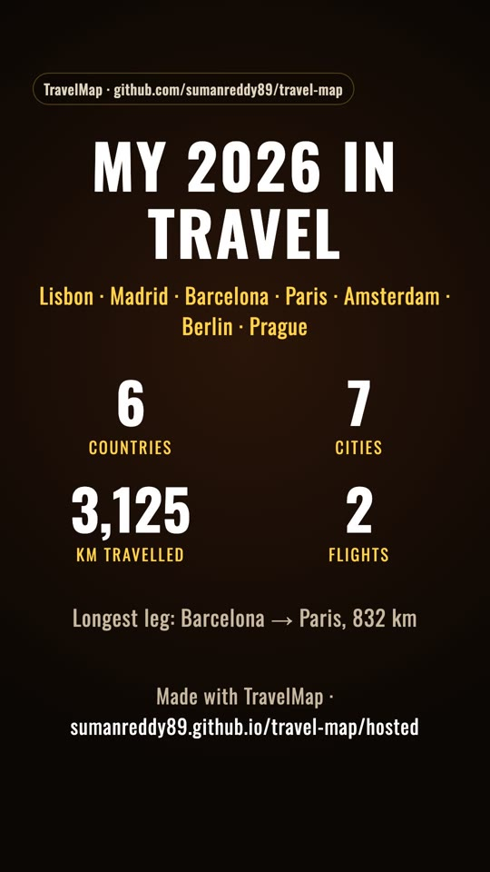

# TravelMap

**Paste your cities, get your year film.** An animated map flies your year, city by city, by plane, train or car. It opens by counting up your countries, cities, kilometres and flights, and ends on a card you can share. Open source, no API keys.

[](https://github.com/sumanreddy89/travel-map/releases/download/demo-film-v5/demo-year-landscape.mp4)

*Sample year: Lisbon → Madrid → Barcelona → Paris → Amsterdam → Berlin → Prague (48s, with music). [Landscape](https://github.com/sumanreddy89/travel-map/releases/download/demo-film-v5/demo-year-landscape.mp4) · [portrait, for phones](https://github.com/sumanreddy89/travel-map/releases/download/demo-film-v5/demo-year-portrait.mp4) · [16-second vertical clip](https://github.com/sumanreddy89/travel-map/releases/download/demo-film-v5/demo-year-reels.mp4)*

| It counts your year up | Then flies it | And ends on a card to share |
|---|---|---|
|  |  |  |

### Try it: no keys, no map download

```bash
npm ci
npm run demo:prepare                                                   # one-time headless browser download
node remotion/scripts/demo.mjs render --trip year --orientation portrait   # out/demo-year-portrait.mp4
```

Leave out `--orientation portrait` for landscape. The sample year is checked in and renders with the network blocked.

### Your own year: no keys

Write one city per line, in the order you went: `city | date | how you got there` (plane, train or car; plane if left out). Add a country when a name is ambiguous (`Valencia, ES`).

```text
Lisbon | 2026-02-14
Madrid | 2026-03-20 | plane
Barcelona | 2026-04-02 | train
```

```bash
npm run year -- my-year.txt --orientation portrait   # out/year-2026-portrait.mp4
```

Cities come from a bundled list of about 1,250 major cities, English names included ([Natural Earth](https://www.naturalearthdata.com/), public domain), so nothing is looked up online. A line it can't read is reported with its line number and what to change. The map needs the one-time [cartography download](#cartography-data-one-time-not-in-the-repo---600mb-raw) (no keys); road routes for car and train legs come from the public OSRM server while the map is prepared. There's also an API: `POST /api/trips/year` with `{"text": "..."}`.

**Don't want to set anything up?** A hosted version is being considered. [Join the waitlist](https://sumanreddy89.github.io/travel-map/hosted/) if you'd use it.

## Trip films: your photos at every stop

For a single trip, TravelMap cuts from the map to your own photos and videos at each stop, with AI-written narration.

[](https://github.com/sumanreddy89/travel-map/releases/download/demo-film-v5/demo-landscape.mp4)

*The trip demo, "Porto to Palma" (50s, with music): by car, train and plane. [Landscape](https://github.com/sumanreddy89/travel-map/releases/download/demo-film-v5/demo-landscape.mp4) · [portrait](https://github.com/sumanreddy89/travel-map/releases/download/demo-film-v5/demo-portrait.mp4). Render it yourself, keyless: `npm run demo:render` (add `-- --orientation portrait` for phones).*

| The route draws itself | Then your photos at each stop | Portrait, for phones |
|---|---|---|
|  |  |  |

Photo, map and music sources: [docs/demo/ASSETS.md](docs/demo/ASSETS.md). More: [docs/demo/README.md](docs/demo/README.md).

## Full workflow: your own trips

Making films of your own trips needs API keys (narration and voiceover use paid services) and a one-time ~600MB map-data download, as below. What leaves your machine is listed under [What stays on your machine](#what-stays-on-your-machine).

### Setup

You need Node.js 20 or newer and ffmpeg (which includes `ffprobe`; macOS: `brew install ffmpeg`, Ubuntu: `sudo apt install ffmpeg`).

```bash
npm install
```

Copy `server/.env.example` to `server/.env` and fill in your own keys:

```bash
cp server/.env.example server/.env
```

```
ANTHROPIC_API_KEY=...     # console.anthropic.com - narration + closing lines
ELEVENLABS_API_KEY=...    # elevenlabs.io - voiceover TTS
ELEVENLABS_VOICE_ID=...   # must be a voice available to your ElevenLabs plan/account
PORT=4000
```

### Cartography data (one-time, not in the repo - ~600MB raw)

Map scenes need Natural Earth boundary + shaded-relief data. It's gitignored
rather than committed, so fetch and convert it once:

```bash
mkdir -p data/geo-raw && cd data/geo-raw
curl -sS -o countries.zip https://naciscdn.org/naturalearth/10m/cultural/ne_10m_admin_0_countries.zip
unzip -q countries.zip -d countries
curl -sS -o admin1.zip https://naciscdn.org/naturalearth/10m/cultural/ne_10m_admin_1_states_provinces.zip
unzip -q admin1.zip -d admin1
curl -sS -o relief.zip https://naciscdn.org/naturalearth/10m/raster/NE1_LR_LC_SR_W.zip
unzip -q relief.zip -d relief_hr
cd ../../server && npx tsx src/scripts/convertGeo.ts
```

That last command writes `remotion/public/geo/countries.json` and `admin1.json`.

### Check your setup

```bash
npm run doctor
```

It checks Node, ffmpeg and ffprobe, your keys in `server/.env` (without printing them) and the converted map data, and says how to fix anything missing. It doesn't call any paid service.
Per-country terrain textures (`remotion/public/terrain/*.png`) generate and
cache automatically the first time a trip visits that country.

## Run

```bash
npm run dev:server   # API on http://localhost:4000
npm run dev:web      # UI on http://localhost:5173
```

Open http://localhost:5173, create a trip, add stops (search or click the
map), upload photos/videos per stop, then click "Generate video".

## Preview map/scene work in isolation

```bash
npm run studio   # opens Remotion Studio with the demo trip (remotion/src/demo/demoProps.json)
```

## Notes

- Videos carry a small "TravelMap · github.com/sumanreddy89/travel-map" credit
  by default; untick "Show TravelMap credit" next to the format choice to drop
  it. Map scenes with a road route also show "Route data © OpenStreetMap
  contributors", which the routing data's licence requires.
- Background music is not auto-downloaded (copyright); drop an mp3/wav/m4a
  into `remotion/public/music/` and it's picked up automatically by every
  render at low volume - no per-trip wiring needed.
- The photo/video panel shown beside the map during transitions can be
  toggled off via `SHOW_MEDIA_PANEL_IN_MAP_SCENES` in `remotion/src/config.ts`.
- `data/` holds all trip content (uploads, generated audio, output videos),
  `data/geo-raw/` the raw Natural Earth source files, and `server/.env` your
  API keys - all gitignored.

## What stays on your machine

Your photos, videos, generated audio and finished videos stay local; the
server only listens on 127.0.0.1. Some trip details do go to outside services
to build the video:

| Service | What it receives |
|---|---|
| Anthropic | Trip title, stop names and your notes, to write the narration |
| ElevenLabs | The narration text, to read it aloud |
| OpenStreetMap Nominatim | Place names you search for |
| OSRM (project-osrm.org) | Stop coordinates, to draw the route |
| OpenFreeMap | Map tile requests for the area you're viewing |

## Tests

```bash
npm test
```

## Licence

Code: [MIT](LICENSE). The music once tracked in this repo is not covered and
stays all rights reserved; demo assets keep their own licences. See
[NOTICE.md](NOTICE.md) and [docs/demo/ASSETS.md](docs/demo/ASSETS.md).
